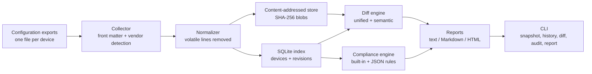

# netconfig-vault

Offline configuration backup, versioning and compliance auditing for Cisco IOS and Aruba/HP network devices.

[](https://github.com/jeremydacosta-TechOptimist/netconfig-vault/actions/workflows/ci.yml)


Network changes usually leave two artefacts: a ticket that says what was intended and a
device that may or may not have received it. netconfig-vault keeps the evidence: it
collects exported device configurations into a local vault, stores each content-addressed
revision once, diffs revisions and audits the latest configuration against explicit Cisco
IOS and Aruba/HP baselines. It targets small network teams, home labs and students who
need a reproducible, offline paper trail.

Collection is directory based: export running configurations from your backup workflow
(for example, `show running-config` redirected to a file) and point the tool at the
folder. Live SSH collection is intentionally not implemented.

## Features

- **Directory collector.** Scans per-device exports, reads `# device:`, `# vendor:`,
  `# site:` and `# role:` front matter, falls back to the file name and detects vendors.
- **Content-addressed store and immutable history.** Normalized configurations are
  hashed with SHA-256, identical blobs are stored once, and every snapshot is a numbered,
  timestamped revision with an optional note in a SQLite index; unchanged devices are
  reported as unchanged instead of duplicating history.
- **Diff engine.** Unified diff plus a semantic summary of interfaces added, removed and
  modified, ACL and routing line counts, line counts and configuration size delta.
- **Compliance engine.** 21 built-in checks for Cisco IOS and Aruba/HP (SSHv2, no
  Telnet, NTP, syslog, banner, AAA, cleartext HTTP, default SNMP communities, plaintext
  passwords, VLAN 1 access ports) plus JSON rule files for site-specific checks.
- **Reports.** Console summaries and Markdown or standalone HTML compliance, change and
  estate reports with remediation guidance and no external assets.
- **Pipeline-friendly CLI.** `audit` exits with code 1 when a critical finding exists
  (adjustable with `--fail-on`), so it can gate a change pipeline; exit codes are
  documented in `--help`.
- **Zero runtime dependencies.** Python 3.10+ standard library only, fully offline.

## Quick start

```powershell
git clone https://github.com/jeremydacosta-TechOptimist/netconfig-vault.git
cd netconfig-vault
python -m pip install -e .
netvault init
```

```text
Vault ready at: vault
Schema version: 1
Devices in vault: 0
```

A configuration export is any `.cfg`, `.conf` or `.txt` file. Metadata is optional but
recommended:

```text
# device: core-sw-01
# vendor: cisco-ios
# site: porto-lab
# role: core-switch
```

Without a header the device name comes from the file name and the vendor is detected
from the configuration. See `examples/lab-configs/`; from a source checkout without
installation, run `$env:PYTHONPATH = "src"; python -m netvault --help`.

## Usage

Commands: `init`, `snapshot DIR`, `devices`, `history DEVICE`, `diff DEVICE REV1 REV2`,
`audit`, `report`. The examples use the lab configurations shipped in this repository;
all output was captured from a real run.

### Collect snapshots

```console
$ netvault snapshot examples/lab-configs/baseline
Collecting from examples/lab-configs/baseline
  access-aruba-01 (Aruba / HP): revision 1 created, digest 99d6bbe7cf62, 42 lines
  core-sw-01 (Cisco IOS): revision 1 created, digest 901696fe0da2, 89 lines
  edge-rtr-01 (Cisco IOS): revision 1 created, digest 7ff6f46e79bd, 65 lines
Summary: 3 new revision(s), 0 unchanged, 0 error(s)
```

Running it again reports `0 new revision(s), 3 unchanged` because identical content is
deduplicated; `netvault history core-sw-01` lists numbered revisions with digests.

### Review a change

Collecting the drifted exports creates revision 2 of each device; the change report
summarises what moved before the unified diff is attached to a ticket.

```console
$ netvault snapshot examples/lab-configs/drift
Collecting from examples/lab-configs/drift
  access-aruba-01 (Aruba / HP): revision 2 created, digest 858a297b8426, 51 lines
  core-sw-01 (Cisco IOS): revision 2 created, digest 32b9b22cf27a, 103 lines
  edge-rtr-01 (Cisco IOS): revision 2 created, digest 2da8f4354897, 68 lines
Summary: 3 new revision(s), 0 unchanged, 0 error(s)

$ netvault diff core-sw-01 1 2 --summary-only
Change summary - core-sw-01 (revision 1 -> 2)
  lines: +15 / -1 (net +14)
  size: +339 bytes
  interfaces added: GigabitEthernet0/5
  interfaces removed: none
  interfaces modified: GigabitEthernet0/1, Vlan10
  ACL lines: +3 / -0
  route lines: +1 / -0
```

Without `--summary-only` the command appends a unified diff; `--format md|html --out
report.md` writes the full change report with both sections.

### Audit compliance

```console
$ netvault audit --rules examples/rules/lab-baseline.json
Compliance audit - 3 device(s), 23 rule definition(s) (21 built-in, 2 custom)
overall: FAIL - 2 critical, 4 high, 1 medium failure(s)
weighted score: 78.6%

access-aruba-01 (Aruba / HP, rev 2): score 84.6% (10 pass, 2 fail, 0 skip)
  FAIL high     ARUBA-WEB-001        Cleartext web management disabled
  FAIL high     LAB-LOG-001          All devices log to the lab syslog collector

core-sw-01 (Cisco IOS, rev 2): score 100.0% (13 pass, 0 fail, 0 skip)

edge-rtr-01 (Cisco IOS, rev 2): score 51.5% (8 pass, 5 fail, 0 skip)
  FAIL critical CISCO-SNMP-001       No default SNMP community strings
  FAIL critical CISCO-TELNET-001     VTY transport restricted to SSH (no Telnet)
  FAIL high     CISCO-HTTP-001       Cleartext HTTP management server disabled
  FAIL high     LAB-LOG-001          All devices log to the lab syslog collector
  FAIL medium   CISCO-LOG-001        Remote syslog server configured

Summary: 31 pass, 7 fail, 0 skip
```

The command exits with code 1 because critical findings exist (documented in `--help`;
use `--fail-on` to change the threshold). `--format md|html --out report.md` writes a
compliance report with per-rule remediation, and `netvault report` combines inventory,
recent changes and compliance into one estate report. See `docs/rules.md` for the rule
format and baseline catalogue.

## Architecture



The collector validates exports and derives metadata; the normalizer strips volatile
header lines and line-ending differences so identical device states hash identically. The
store writes normalized content once as a SHA-256 blob and records devices, revisions and
notes in SQLite, enabling deduplication and ordered history. The diff engine compares
revision text while the compliance engine evaluates the latest revision against baselines
and JSON rules; both reuse the same stored content. Report renderers produce console,
Markdown and self-contained HTML output, and the CLI wires the flow together.

## Project layout

```text
netconfig-vault/
├── .github/workflows/ci.yml
├── docs/rules.md
├── examples/
│   ├── lab-configs/baseline/   access-aruba-01.cfg, core-sw-01.cfg, edge-rtr-01.cfg
│   ├── lab-configs/drift/      access-aruba-01.cfg, core-sw-01.cfg, edge-rtr-01.cfg
│   └── rules/lab-baseline.json
├── src/netvault/
│   ├── __init__.py
│   ├── __main__.py
│   ├── baselines.py
│   ├── cli.py
│   ├── collector.py
│   ├── compliance.py
│   ├── diffing.py
│   ├── models.py
│   ├── normalize.py
│   ├── reports.py
│   ├── rules.py
│   └── store.py
├── tests/                      test_cli.py, test_collector.py, test_compliance.py,
│                               test_diff.py, test_normalize.py, test_reports.py,
│                               test_store.py
├── .gitignore
├── LICENSE
├── pyproject.toml
└── README.md
```

The vault itself (`vault/` by default, configurable with `--vault` or `NETVAULT_VAULT`)
holds `vault.db` and `objects/`; it is runtime data and is ignored by Git.

## Testing

From the repository root, with the package installed (`pip install -e .`) or sourced via
`PYTHONPATH`:

```powershell
$env:PYTHONPATH = "src"
py -3.13 -m pytest -q
python -m unittest discover -s tests -v
python -m netvault --help
python -m compileall -q src tests
```

```text
160 passed, 87 subtests passed in 12.37s
Ran 160 tests in 11.748s
OK
```

The seven `unittest.TestCase` modules cover normalization and hashing, collection and
vendor detection, store deduplication and history ordering, unified and semantic diffs, a
pass and a fail case for every built-in compliance rule, JSON rule validation, report
markers and escaping, and the full CLI workflow through `subprocess` with `PYTHONPATH`
preserved. Tests are deterministic, offline and use temporary vault directories.

## Roadmap

- SSH/SCP and vendor API collection adapters behind the existing collector interface.
- Versioned site profiles with rule inheritance, replacing the per-run `--rules` list.
- Retention and integrity tooling: prune old blobs safely and verify indexed blobs.
- `audit --revision` to evaluate historical revisions and track compliance drift.

## Resumo em português (PT-PT)

- Ferramenta de linha de comandos, sem dependências externas, que guarda exportações de
  configuração de equipamentos de rede num cofre local com índice SQLite e conteúdos
  endereçados por SHA-256.
- Recolhe ficheiros de configuração de uma árvore de diretórios, identifica o fabricante
  (Cisco IOS ou Aruba/HP) e mantém um histórico imutável por equipamento, deduplicando
  conteúdos idênticos.
- Compara duas revisões com diff unificado e um resumo semântico de interfaces, ACL,
  rotas e dimensão da configuração.
- Audita a configuração mais recente contra baselines e ficheiros de regras JSON, com
  pontuação ponderada por severidade, e gera relatórios Markdown e HTML autónomo.

## License

MIT © 2026 Jeremy da Costa — see [LICENSE](LICENSE).
